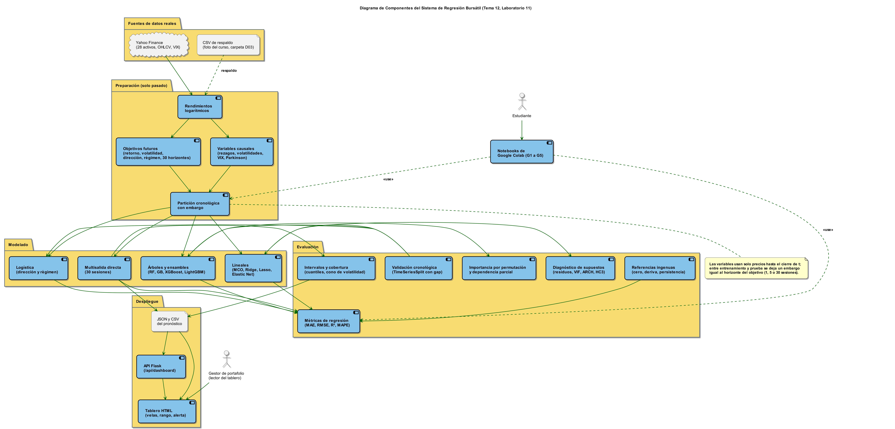
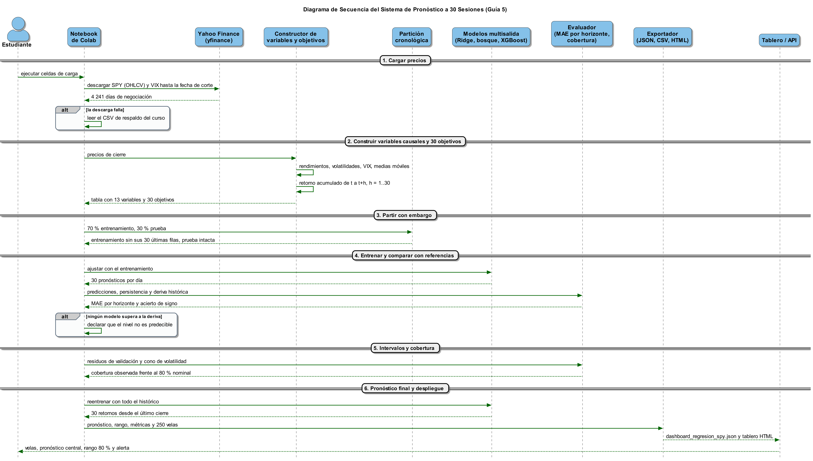
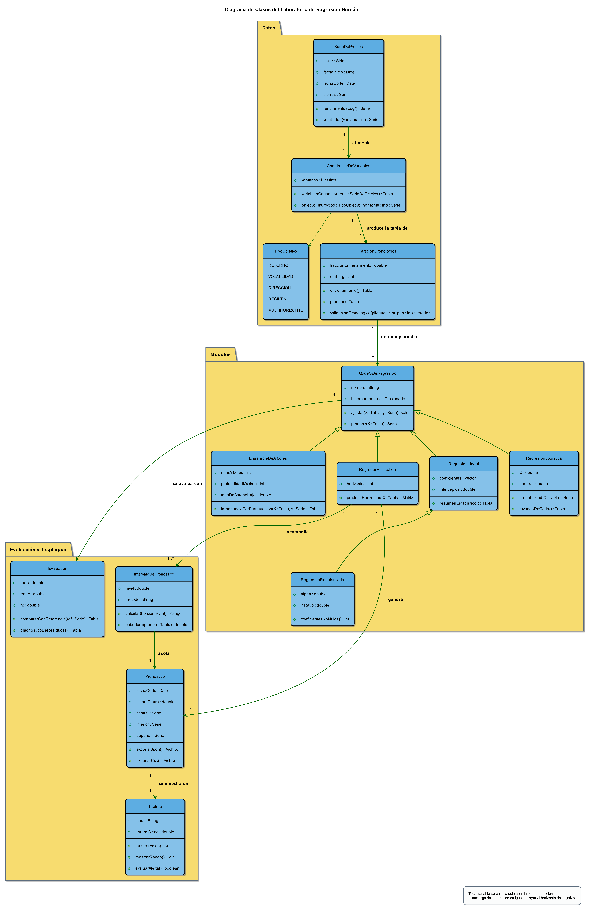
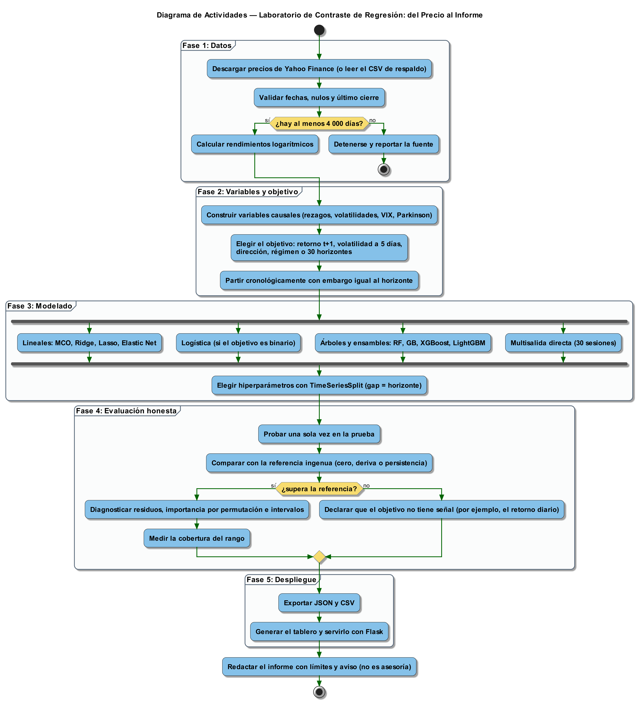
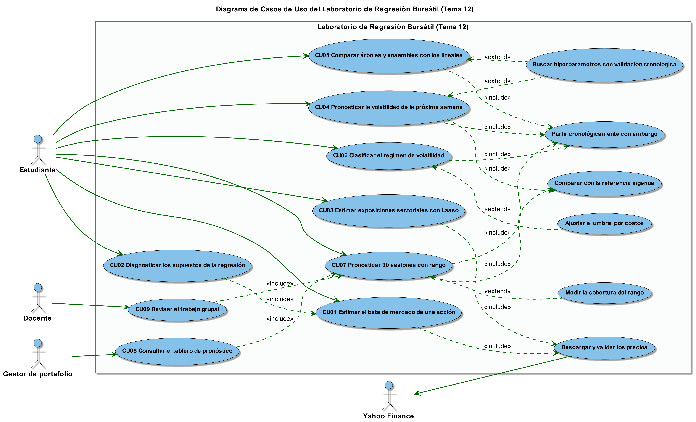

# Modelos de regresión para el mercado bursátil — Laboratorio 11 (Minería de Datos)

**ES** · Cinco notebooks de Python, ya ejecutados, que recorren la regresión aplicada a datos reales de la bolsa (Yahoo Finance): desde el beta de una acción hasta un sistema de pronóstico a 30 sesiones con intervalos y tablero web. Cada notebook sigue las fases de CRISP-DM, fija la semilla 2026 y compara cada modelo con una **referencia ingenua** (retorno cero, deriva histórica o persistencia) antes de afirmar que "funciona".

**EN** · Five executed Python notebooks that walk through regression on real stock-market data (Yahoo Finance): from a stock's market beta to a 30-session forecasting system with prediction intervals and a web dashboard. Every notebook follows CRISP-DM, uses seed 2026 and benchmarks each model against a **naive baseline** (zero return, historical drift or persistence).

Material elaborado para el curso de Minería de Datos de la FISI-UNMSM (semestre 2026-II, Tema 12: Modelos de Regresión), por Ernesto D. Cancho-Rodríguez.

## Contenido

| # | Notebook | Pregunta que responde | Técnicas |
|---|---|---|---|
| 1 | `26.11.12.Lab11-G1_Regresion_ejecutado.ipynb` | ¿Cuánto se mueve una acción cuando se mueve el mercado, y es confiable ese número? | Regresión lineal simple y múltiple, beta de mercado, diagnóstico de supuestos, MAE/RMSE/R² |
| 2 | `26.11.12.Lab11-G2_Regresion_ejecutado.ipynb` | ¿A qué sectores está expuesta una acción cuando los regresores están correlacionados? ¿Cuántas de 65 variables sirven? | Ridge, Lasso, Elastic Net, validación cruzada temporal, VIF |
| 3 | `26.11.12.Lab11-G3_Regresion_ejecutado.ipynb` | ¿Cuánto ganan los árboles y ensambles sobre un modelo lineal ante no linealidades e interacciones (VIX)? | Árbol, Random Forest, Gradient Boosting, XGBoost, LightGBM, importancia por permutación |
| 4 | `26.11.12.Lab11-G4_Regresion_ejecutado.ipynb` | ¿Sube SPY mañana? ¿En qué régimen de volatilidad está el mercado? | Regresión logística, calibración, curvas ROC, clasificación con referencia ingenua |
| 5 | `26.11.12.Lab11-G5_Regresion_ejecutado.ipynb` | ¿Cuánto valdrá SPY dentro de 30 sesiones, con qué rango? | Pronóstico directo multisalida, Ridge y Random Forest, cono de volatilidad, cobertura del intervalo, tablero HTML |

Los notebooks de las guías 2 a 5 construyen sobre los anteriores: la progresión va del modelo lineal al sistema completo.

## Datos de respaldo

Cada notebook descarga primero los precios con `yfinance`. Si la descarga falla, lee estos CSV, que deben estar **en la misma carpeta que el notebook** (ya lo están en `notebooks/`):

| Archivo | Contenido | Lo usan |
|---|---|---|
| `26.11.12.cierres_ajustados_28_activos_2010-01-04_2026-11-11.csv` | Cierres ajustados de 28 activos (índices, ETF sectoriales, acciones y VIX), 2010-01-04 a 2026-11-11 | Guías 1 a 5 |
| `26.11.12.SPY_OHLCV_ajustado_2010-01-04_2026-11-11.csv` | Apertura, máximo, mínimo, cierre ajustado y volumen de SPY, mismo período | Guías 2 a 5 |

Los datos provienen de Yahoo Finance y se incluyen solo con fines educativos y de reproducibilidad. **No** están cubiertos por la licencia de este repositorio: los términos de uso de Yahoo rigen su redistribución.

## Tablero y servidor de la Guía 5 (`tablero_g5/`)

La Guía 5 termina escribiendo `dashboard_regresion_spy.json`, `pronostico_30_sesiones_spy.csv` y `08_Tablero_Pronostico_SPY_30_sesiones.html` en la carpeta donde se ejecuta. La carpeta `tablero_g5/` guarda una copia de muestra, generada el 12-nov-2026, para verla sin ejecutar nada:

| Archivo | Qué es |
|---|---|
| `08_Tablero_Pronostico_SPY_30_sesiones.html` | Tablero de un solo archivo con los datos incrustados (velas, pronóstico, rango del 80 %, alerta de precio). Se abre con doble clic; carga ECharts 5.5.1 desde un CDN, así que requiere conexión. |
| `26.11.12.06_Servidor_Flask_Tablero.py` | Servidor Flask mínimo: sirve el tablero en `/` y el JSON en `/api/dashboard`. |
| `dashboard_regresion_spy.json` | Datos del pronóstico que lee el servidor (salida de la Guía 5). |

**Véalo en línea (GitHub Pages):** [tablero del pronóstico de SPY](https://mbaernestocr-tech.github.io/regresion-bursatil-dm-lab11/tablero_g5/08_Tablero_Pronostico_SPY_30_sesiones.html) · [portada](https://mbaernestocr-tech.github.io/regresion-bursatil-dm-lab11/). El servidor Flask no corre en Pages; solo se publica el HTML de un solo archivo.

```bash
cd tablero_g5
python 26.11.12.06_Servidor_Flask_Tablero.py     # abrir http://127.0.0.1:5000
```

## Diagramas UML (`diagramas/`)

Cinco diagramas UML del sistema completo, escritos en [PlantUML](https://plantuml.com/) (`.puml`) y renderizados a imagen (`.png`). Cubren el laboratorio entero, de la Guía 1 a la 5, y no uno por guía.

| Diagrama | Qué muestra | Imagen | Código |
|---|---|---|---|
| Componentes | Fuentes de datos, preparación, modelado, evaluación y despliegue del sistema de regresión bursátil | [PNG](diagramas/26.11.12.T12_UML_01_Componentes.png) | [`.puml`](diagramas/26.11.12.T12_UML_01_Componentes.puml) |
| Secuencia | Cómo se produce el pronóstico a 30 sesiones de la Guía 5 | [PNG](diagramas/26.11.12.T12_UML_02_Secuencia.png) | [`.puml`](diagramas/26.11.12.T12_UML_02_Secuencia.puml) |
| Clases | Clases del laboratorio de regresión bursátil | [PNG](diagramas/26.11.12.T12_UML_03_Clases.png) | [`.puml`](diagramas/26.11.12.T12_UML_03_Clases.puml) |
| Actividades | Flujo del laboratorio de contraste de regresión, del precio al informe | [PNG](diagramas/26.11.12.T12_UML_04_Actividades.png) | [`.puml`](diagramas/26.11.12.T12_UML_04_Actividades.puml) |
| Casos de uso | Actores y casos de uso del laboratorio | [PNG](diagramas/26.11.12.T12_UML_05_Casos_de_Uso.png) | [`.puml`](diagramas/26.11.12.T12_UML_05_Casos_de_Uso.puml) |











Los PNG son grandes (hasta unos 10 000 píxeles de ancho): en GitHub se ven reducidos y se amplían al abrirlos. Para regenerarlos desde el código, `plantuml -tpng diagramas/*.puml`.

## Cómo ejecutarlos

```bash
git clone https://github.com/mbaernestocr-tech/regresion-bursatil-dm-lab11.git
cd regresion-bursatil-dm-lab11
python -m venv .venv && source .venv/bin/activate      # en Windows: .venv\Scripts\activate
pip install -r requirements.txt
cd notebooks
jupyter lab
```

En Google Colab: abra el notebook, instale las librerías que falten y, si desea usar el respaldo sin conexión, suba también los dos CSV al entorno.

## Entorno con el que se ejecutaron

Python 3.10 · scikit-learn 1.3.1 · XGBoost 3.2.0 · LightGBM 4.5.0 · statsmodels 0.14.0 · pandas 2.2.3 · numpy 1.26.4 · yfinance 1.2.0, en Windows con CPU, el 12-nov-2026, con precios hasta el cierre del 11-nov-2026. No se ejecutaron en Google Colab.

Nota: en Windows, LightGBM 4.7.0 junto con XGBoost 3.2.0 puede cerrar Python con "access violation"; se usó LightGBM 4.5.0.

## Alcance y advertencias

- Material **educativo**. Nada de lo que contiene es asesoría de inversión.
- Las cifras de los notebooks vienen de datos reales descargados en esa fecha; si Yahoo revisa precios históricos, los resultados pueden moverse levemente.
- Un resultado sobre datos sintéticos demuestra un mecanismo, no un hecho del mercado; los notebooks indican en cada caso qué datos usan.
- Parte del código y de los textos se elaboró con asistencia de IA generativa (Claude, de Anthropic), y el autor revisó el contenido y responde por él.

## Licencia

© 2026 Ernesto D. Cancho-Rodríguez. Notebooks, código y textos bajo [Creative Commons Atribución 4.0 Internacional (CC BY 4.0)](https://creativecommons.org/licenses/by/4.0/); el texto legal está en [`LICENSE`](LICENSE). Los datos de Yahoo Finance quedan fuera de esta licencia, como se explica arriba.
